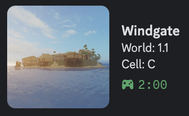

# Windgate RPC

Custom Discord Rich Presence for [Windgate](https://www.roblox.com/games/3540051865/Windgate), a Roblox open-world sandbox game by Defaultio.

Roblox's built-in Discord integration only shows that you are playing *Roblox* — not which game, and certainly not where you are inside it. Windgate RPC shows your current **world and cell** on your Discord profile, so other players can find you.

<p align="center">
  
</p>


---

## Quick start

1. Download the executable for your platform from the [Releases](../../releases) page.
2. Run it. Keep it open while you play.
3. Your Discord profile updates automatically.

No configuration, no credentials, no account linking required.

---

## Why this is harder than it looks

Roblox does not expose "what game is this user playing" through OAuth2. The only endpoint that returns presence data requires a `.ROBLOSECURITY` session cookie — the same cookie that account-stealing scams target.

The obvious implementation would ask each user to paste their own cookie into the app. That is exactly the behaviour players are warned never to do, and it is why this project sat unfinished for four years.

**The workaround:** the presence endpoint does not require *your* cookie — it requires *a* cookie from any account that would be able to see your presence on the website. So the cookie belongs to a dedicated service account and lives only on a remote server. The client on your machine never handles a credential of any kind.

---

## Architecture

```
┌──────────────────────────┐
│   Your machine           │
│                          │
│  ┌────────────────────┐  │   HTTPS    ┌─────────────────────┐
│  │  Windgate RPC CLI  │──┼───────────>│  windgate_rpc_server│
│  │  (TypeScript)      │<─┼────────────│  (Fastify, Railway) │
│  └─────────┬──────────┘  │            └──────────┬──────────┘
│            │ IPC         │                       │ service account
│            v             │                       v
│  ┌────────────────────┐  │            ┌─────────────────────┐
│  │  Discord (local)   │  │            │     Roblox API      │
│  └────────────────────┘  │            └─────────────────────┘
└──────────────────────────┘
```

| Component | Responsibility |
|---|---|
| **CLI** (this repo) | Polls the server, resolves the player's position, drives the local Discord RPC socket |
| **[Server](https://github.com/pedromlabio/windgate_rpc_server)** | Holds the service-account credential, calls the Roblox API, returns only the data the client needs |

Putting the API calls behind a server has a second benefit: the Roblox integration can change without shipping a new build to every user.

## Locating the player

Windgate splits each world into a 5×5 grid, and **every cell is a separate Roblox place**. Cell names encode direction from the center: `C` is the center, `N` is one cell north, `NE` one cell northeast, `NNEE` two cells northeast, and so on.

Because the naming is predictable, the place identifier returned by the API can be mapped back to a world and a pair of grid coordinates — which is what ends up on your Discord profile.

## Stack

TypeScript · Node.js · Discord RPC

## Related

- [`windgate_rpc_server`](https://github.com/pedromlabio/windgate_rpc_server) — the backend

## Acknowledgements

Thanks to [@jvopinho](https://github.com/jvopinho) for the early guidance on Discord's API back when I had never touched JavaScript.
